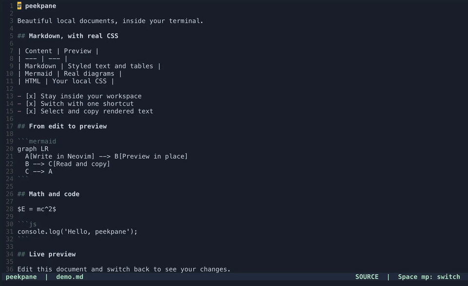

# peekpane

[](https://github.com/yoshimi-I/peekpane/actions/workflows/ci.yml)

<p align="center">
  
</p>

ローカルファイルをターミナル内でCSS付きプレビューするツールです。単体のCLIとNeovimプラグインの2通りで使え、描画エンジンは共通です。現在は初期開発版です。npmには未公開です。仕様の正本は [English README](README.md) です。

使い方に合わせて導入方法を選んでください。

| 利用する場所 | 導入先 | インストールするもの |
| --- | --- | --- |
| ターミナル・AIエージェントCLI | [Terminal CLI](#terminal-cli) | 単体コマンド。エージェント用ルールは任意。Neovimは不要です。 |
| Neovim | [Neovim plugin](#neovim-plugin) | lazy.nvimでプラグインを導入。付属CLIを直接使うため、グローバルCLIの導入は不要です。 |

どちらも[対応ターミナルの条件](#対応ターミナルと検証範囲)を満たす必要があります。

## デモ



上のGIFは自動再生・ループします。[収録方法](docs/demo/README.md)。

英語のデモで、ソースとプレビューの切り替え、Markdown・Mermaid・文字選択・保存前の更新・HTMLを紹介しています。

## 共通の必要条件

Node.js 20以上、macOS/Linux、Kitty graphics対応ターミナルが必要です。すべてのターミナルで動くわけではありません。tmuxはペインを管理しますが、非対応ターミナルに画像描画機能を追加するものではありません。`npm ci`で描画用のPixelとElectronランタイムを導入します。ブラウザアプリの別途インストールは不要です。初回インストール時のみダウンロードが発生します。

### 対応ターミナルと検証範囲

| 環境 | 分割表示の条件 | 検証状況 |
| --- | --- | --- |
| macOS + Ghostty 1.3以上 | Ghostty標準の分割を使用。tmux不要。Quick Terminalにも対応。 | Ghostty 1.3.1でMD・HTMLの表示を実機確認済み。 |
| macOS + Ghostty + tmux 3.2以上 | Kitty graphics対応とtmuxの分割を使用。 | tmux利用時も実機確認済み。 |
| Linux + Ghostty | 分割にはtmux 3.2以上が必要。Kitty graphics対応も必要。 | Linux CIの通過は実ターミナルでの表示確認を意味しません。 |
| その他のmacOS/Linuxターミナル | Kitty graphics対応に加え、対応する分割アダプターかtmux 3.2以上が必要。 | 全端末では未検証。アダプターの存在だけで動作保証はできません。 |
| Windows | 現在のCLIでは非対応。 | 未検証。 |

エージェントのルールやskillを導入しても、ターミナル側の描画・分割機能は追加されません。[詳しい対応条件](docs/installation.md#terminal-compatibility)。

## Terminal CLI

シェルやCodex・Claude Code・Kiro CLIからファイルをプレビューする使い方です。Neovimは不要です。

### CLIのインストール

```sh
git clone https://github.com/yoshimi-I/peekpane.git
cd peekpane
./install.sh
peekpane README.ja.md
```

この手順はターミナル用コマンドだけを導入します。AIエージェントに「プレビューして」と頼んで開かせる場合は、任意の[エージェント連携](#エージェント連携任意)を追加してください。[導入先・確認・削除の手順](docs/installation.md)。

### 使い方

```sh
peekpane report.md:42 --split left --size 0.45
peekpane image.png
peekpane scroll report.md 80
printf '# 保存前の内容\n' | peekpane push report.md --line 1
peekpane ls --json
peekpane focus
peekpane zoom
peekpane close report.md
peekpane close
```

CLIとNeovimプラグインは、Markdown、Mermaid、HTML、画像、PDF、動画、音声、CSV/TSV、Excel、JSON/YAML、テキストに対応します。Markdownの表・チェックボックス・脚注・コードハイライト・数式にも対応します。MDXのJSXは実行しません。Mermaidは図があるときだけ読み込みます。画像は幅合わせと等倍を切り替えられ、表は見出しをクリックして並べ替えられます。

複数のプレビューでElectron本体とGPUなどの補助プロセスを共有し、最後のプレビューを閉じると終了します。文書用の描画上限は既定30fpsです。連携にはキャッシュ内の権限を制限したUnixソケットを使い、TCPポートは開きません。

タブやアドレスバーはなく、CSS付きの本文だけを表示します。ファイルの変更通知から画面へ直接更新を送り、定期的な画面側の確認処理は行いません。カーソル移動だけでは本文を再描画しません。同じファイルは再利用します。`--type`で種類を指定、`--css`でローカルCSSを追加できます。終了コードは成功0、実行時エラー1、引数エラー2です。

### プレビューを閉じる

Ghostty標準分割のプレビューは、そのペインをクリックして **Cmd+W**（既定の`close_surface`）で閉じられます。確認が出たら閉じる操作を選んでください。元のシェルから`peekpane close /ファイルの絶対パス`でも閉じられます。`q`はsplitビューの終了キーではありません。

### 対話型ビューアでの文字選択

右側のWebViewにはHTMLの文字情報が残っています。マウスで文字を選択して`y`またはCmd+Cでコピーできます。キーボードでは`v`で選択を始め、`h/l`で文字、`w/b`で単語、`j/k`で表示行に沿って範囲を伸ばし、`y`でコピーします。Escapeで選択解除します。選択中でない`j/k`はWebViewを直接スクロールします。この操作はsplit/toggleの対話型ビューア用です。

MarkdownやローカルHTML内のHTTP/HTTPSリンクをクリックすると、ローカルのプレビューを残したまま既定のブラウザで開きます。Neovimの`window`モードのマウス操作でも利用できます。外部の画像・CSS・スクリプトはプレビュー内へ読み込みません。

### CLIの設定

`~/.config/peekpane/config.json`にdisplay、split、size、focus_key、zoom_key、cssを設定できます。キーにfalseを指定すると無効になります。tmuxでは既定のAlt+Pでフォーカス切り替え、Alt+Shift+Pでズームします。`close`で最後のプレビューを閉じると元のバインドを復元します。tmux外ではフォーカス・ズームは使えません。

### エージェント連携（任意）

```sh
node scripts/install-agents.js --agent all --scope user --dry-run
node scripts/install-agents.js --agent all --scope user
```

Codexは`~/.codex/AGENTS.md`、Claude Codeは`~/.claude/CLAUDE.md`、Kiro CLIは`~/.kiro/steering/peekpane.md`へ導入します。`--scope project --project /対象プロジェクト`ならプロジェクト内だけに設定できます。`--uninstall`はpeekpaneのルールだけを削除します。既存設定のバックアップを保存し、他の指示や許可設定は変更しません。Kiroのカスタムエージェントにはsteeringファイルを`resources`へ追加する必要があります。[詳しい手順とトラブル対応](docs/installation.md)。

`--scope user`は、同じマシン・同じOSユーザー・同じエージェント設定を使う別プロジェクトや別ターミナルのセッションにも適用するための設定です。ほかのユーザーやマシン、独立したエージェント設定には自動で引き継がれません。導入後は新しいエージェントセッションを開始してください。

このルールは「プレビューして」と頼まれた際にコマンドを実行させるもので、すべての回答を自動表示する設定ではありません。別のターミナルで利用する場合も、そのターミナル自体が対応条件を満たす必要があります。

[skills/peekpane/SKILL.md](skills/peekpane/SKILL.md)は任意のskill連携です。ルール導入とskill導入は別で、`install.sh --agent all --scope user`が導入するのは共通ルールです。任意のskillは別途導入し、既存skillは上書きしません。Kiroはsteeringファイルの導入をテストしていますが、開発環境にKiro CLIがなく、実際のセッションでの読み込みは未検証です。

## Neovim plugin

現在のバッファをプレビューし、未保存の変更やカーソル移動に追従させる使い方です。プラグインを直接導入できるので、`install.sh`の実行やグローバルCLI、エージェント用ルールの導入は不要です。

### lazy.nvimでインストール

Neovim 0.10以上、Node.js 20以上、npm、対応ターミナルが必要です。`window`モードのマウス連携にはNeovim 0.11以上が必要です。lazy.nvimの設定に追加してください。

```lua
{
  'yoshimi-I/peekpane',
  main = 'peekpane',
  build = 'npm ci',
  cmd = { 'Peek', 'PeekScroll', 'PeekFocus', 'PeekZoom' },
  keys = {
    { '<leader>mp', '<cmd>Peek toggle<cr>', desc = 'Preview: toggle' },
  },
  opts = function(plugin)
    return {
      display = 'split', split = 'right', size = 0.45, follow_cursor = true,
      cmd = { 'node', plugin.dir .. '/bin/peekpane.js' },
    }
  end,
}
```

`build`がプラグイン内に依存関係を導入し、`cmd`が付属CLIを直接呼びます。Node.jsとnpmはNeovimのPATH上に必要です。この例では`<leader>mp`で横並びのプレビューを切り替えます。既定の表示モードは`split`です。

### 表示モードと操作

表示方法は`setup` / lazy.nvimの`opts`で選べます。

```lua
display = 'window' -- 現在のNeovimウィンドウだけをプレビューに切り替える
-- display = 'toggle' -- tmuxウィンドウ全体を全画面で切り替える
-- display = 'split' -- 横に並べる（既定）
```

`window`モードはimage.nvim（Kitty対応バックエンド）とImageMagickが必要です。描画結果を同じNeovimウィンドウ内の専用バッファに表示するため、右の会話欄などは変わりません。ソースとの切り替えは`Space m p`のみで、`i`・`q`・Alt+Pでは解除されません。`j/k`とCtrl-d/uでスクロールします。`v`でHTMLの文字選択を始め、`h/l`・`w/b`・`j/k`で範囲を伸ばし、`y`でVimのレジスタとクリップボードへコピーできます。Escapeは選択解除です。画面転送には画像を使いますが、選択操作とコピーの対象は保持しているHTMLの文字情報です。Vimの全モーションやテキストオブジェクトを再現するものではありません。Neovim 0.11以上ではクリック・ホイール・ドラッグ選択もHTMLへ渡すため、ボタン・チェックボックス・シートタブ・ページ内リンクをマウスで操作できます。選択した文字は`y`・Ctrl+C・Cmd+Cでコピーできます。座標の精度はターミナルの文字セル単位です。プレビュー表示中だけマウス設定を有効にし、閉じると元へ戻します。動画やアニメーションの連続再生には`split`を使ってください。`:Peek close`で描画処理を終了します。

`toggle`モードはtmuxのズームを使うので、ほかのペインも含めたtmuxウィンドウ全体が切り替わります。Alt+Pまたは`:PeekFocus`で往復でき、`:Peek close`で開く前の配置に戻ります。Neovimのバッファそのものを置き換える方式ではありません。現在はtmuxが必要です。横並びの方向と比率は`split` / `size`で設定します。

`:Peek [open|close|toggle] [方向]`、`:PeekScroll [行]`、`:PeekFocus`、`:PeekZoom`を提供します。保存前の変更を150msのデバウンスで送ります。新規ファイルは一度保存してください。バッファやNeovimを閉じると、そのNeovimが開いたプレビューを閉じます。

## セキュリティと制限

表示はfile://とローカル同梱ライブラリだけを使います。peekpane自身は待ち受けポートを開きません。キャッシュは`$XDG_CACHE_HOME/peekpane`または`~/.cache/peekpane`に置き、ディレクトリ700・ファイル600とします。close時に表示内容を削除します。

プレビュー内ではfile/data/blob/aboutのローカル資源だけを許可し、外部通信・外部ページへの移動・ポップアップ・各種権限要求を遮断します。ユーザーが操作したHTTP/HTTPSリンクは専用の連携処理を通して既定ブラウザで開きます。その他の外部URLスキームは開きません。デバッグ用TCPポートも開きません。描画ライブラリのプロセス間連携にはローカルのUnixソケットを使います。生HTMLとローカルJSは実行できるため、信頼できるファイルだけを開いてください。

macOS/Ghostty/tmuxでMarkdown・数式・Mermaid・保存前更新・PNG/SVG・相対パスのHTML/CSS/JS・CSV・Excelを確認しました。起動は手元で約1.5秒、5,001行のMarkdownの本文生成は中央値14msでした。CSS描画用のChromiumのメモリは引き続き必要です。PDF・動画とLinuxの確認状況は[検証記録](docs/validation.md)を参照してください。

開発・テスト・PRの手順は[CONTRIBUTING.md（英語）](CONTRIBUTING.md)、詳細設定は英語READMEを参照してください。[MITライセンス](LICENSE)です。利用ライブラリのライセンス表記は[THIRD_PARTY_NOTICES.md](THIRD_PARTY_NOTICES.md)を参照してください。
