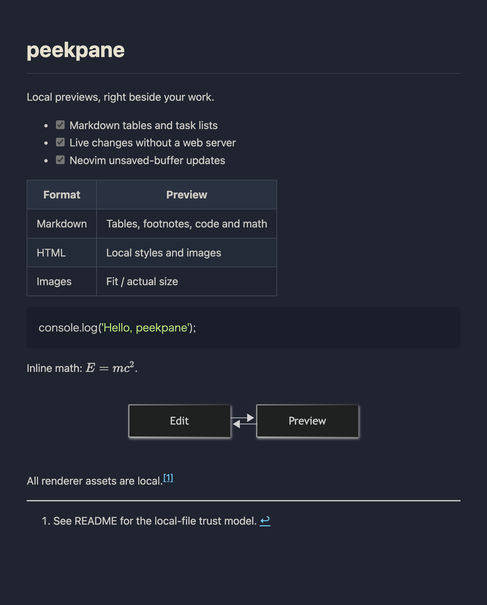

# peekpane

Preview local files beside your terminal or Neovim. Private development release; not published to npm.

[日本語](README.ja.md) · MIT · Node.js 20+

## Install

A terminal with kitty graphics support (such as Ghostty), macOS or Linux, and optional tmux 3.2+ are required. `npm ci` installs the [Pixel](https://github.com/zenbu-labs/terminal-browser/tree/main/pixel) rendering library and its patched Electron runtime. No separate browser installation is needed. The first install downloads the runtime; opening local files does not use a server.

```sh
npm ci
npm link
peekpane README.md
```

Open previews share one Electron host, GPU process and network service. The host exits when its final preview closes. Rendering is capped at 30fps by default for document previews. Communication uses a permission-restricted Unix socket inside the cache directory; no TCP port is opened.

The viewer displays only the document: no tabs, address bar, browser shell, or remote debugging port. Renderer assets are checked in under `assets/`; no build or CDN access is needed when previewing.



## Usage

```sh
peekpane report.md:42 --split left --size 0.45
peekpane open image.png
peekpane scroll report.md 80
printf '# Unsaved\n' | peekpane push report.md --line 1
peekpane ls --json
peekpane focus
peekpane zoom
peekpane close report.md
peekpane close
```

Supported: Markdown/MDX (Markdown syntax only), Mermaid, HTML, images, PDF, video, audio, CSV/TSV, Excel, JSON/YAML and plain text. Markdown includes tables, tasks, footnotes, highlighted code and KaTeX math. Mermaid loads only when a diagram is present. Excel uses SheetJS CE 0.20.3 from its [official distribution](https://docs.sheetjs.com/docs/getting-started/installation/). A viewer cannot add codecs absent from Chromium.

Images have a Fit / Actual size button; CSV and Excel headers sort columns; Excel sheets have tabs. `--type markdown|mermaid|html|image|pdf|video|audio|csv|tsv|excel|json|yaml|text` overrides extension detection. `--css FILE` adds a local stylesheet.

Opening a file again reuses its preview. Filesystem change notifications trigger updates after a short debounce. The viewer receives changes directly; there is no page polling. Moving the cursor does not rerender unchanged content. Errors from rendering a changed file are recorded in its cache directory's `error.txt`; the last successful rendering remains visible. Exit codes: 0 success, 1 runtime error, 2 usage error.

## Configuration

`~/.config/peekpane/config.json` (or `$XDG_CONFIG_HOME/peekpane/config.json`):

```json
{
  "display": "split",
  "split": "right",
  "size": 0.5,
  "focus_key": "M-p",
  "zoom_key": "M-P",
  "css": "/absolute/path/to/custom.css"
}
```

CLI flags take precedence. Set either key to `false` to disable its binding. In tmux the bindings exist while previews are open, then original bindings are restored on `close`. Outside tmux, Pixel’s terminal adapter opens the split; focus and zoom are unavailable. Bindings are server-wide, so avoid simultaneously managing previews from multiple tmux servers with a shared cache. Ghostty Cmd-key translation belongs in your dotfiles.

## Neovim

Choose a display style in `setup` / lazy.nvim `opts`:

```lua
display = 'window' -- replace only the current Neovim window with a preview
-- display = 'toggle' -- switch the whole tmux window to fullscreen preview
-- display = 'split' -- show both side by side (default)
```

`window` mode requires image.nvim (configured with a Kitty-compatible backend and ImageMagick). It displays a locally rendered image in a scratch buffer inside the same Neovim window: `<leader>mp` switches back and forth, `q`/Escape returns to source, `j/k` scrolls, and Ctrl-d/u scrolls by half a page. Other Neovim windows stay unchanged. Window mode is a read-only rendered view; links, sheet tabs and media controls are not clickable. Use `split` mode for interactive content. `:Peek close` releases the renderer.

Toggle mode uses tmux window zoom, so it covers the whole tmux window, including other panes. Alt+P / `:PeekFocus` switches between the full-screen views. `:Peek close` restores the layout from before opening. `split` and `size` control the side-by-side layout and are otherwise secondary to toggle mode. Toggle mode currently requires tmux; this is a view switch, not a Neovim buffer replacement.


Neovim 0.10+, with lazy.nvim:

```lua
{
  'yoshimi-I/peekpane',
  -- dir = vim.fn.expand('~/Desktop/OSS/peekpane'), -- local development
  main = 'peekpane',
  -- dependencies = { '3rd/image.nvim' }, -- required for display='window'
  build = 'npm ci',
  cmd = { 'Peek', 'PeekScroll', 'PeekFocus', 'PeekZoom' },
  keys = {
    { '<leader>mp', '<cmd>Peek toggle<cr>', desc = 'Preview: toggle' },
  },
  opts = function(plugin)
    return {
      split = 'right', size = 0.45, follow_cursor = true,
      cmd = { 'node', plugin.dir .. '/bin/peekpane.js' },
    }
  end,
}
```

This recipe installs dependencies in the plugin checkout and runs its bundled CLI directly; `npm link` is only needed for a global terminal command. Node.js 20+ and npm must be on Neovim’s PATH. During local/private development, uncomment `dir` and point it at your checkout. `:Peek [open|close|toggle] [left|right|up|down]`, `:PeekScroll [line]`, `:PeekFocus`, `:PeekZoom`. Unsaved changes and cursor movements are debounced by 150ms. Save a new buffer once before opening. Only previews owned by this Neovim are closed on exit. No editor keymaps are installed automatically.

## Agents

The portable agent instructions are in [skills/peekpane/SKILL.md](skills/peekpane/SKILL.md). Symlink that folder into your agent's skills directory. A dotfiles `make agents` integration is external to this repository; no permission configuration is modified automatically.

## Privacy and current limitations

Peekpane uses `file://` pages, atomic cache files and no server or listening port of its own. Cache directories use mode 700 and files use 600, under `$XDG_CACHE_HOME/peekpane` or `~/.cache/peekpane`. `peekpane close` removes preview contents.

The viewer permits only `file:`, `data:`, `blob:` and `about:` resource requests, blocks external navigation and popups, and denies camera, microphone and other permission requests. The runtime is started directly without a TCP debugging port. Unix-domain IPC used by the rendering library stays local. Local HTML scripts can run, so open trusted documents only; local resources are not isolated from one another.

Validated on macOS with Ghostty/tmux: Markdown, math/Mermaid, live unsaved updates, PNG/SVG, local HTML/CSS/JS, CSV, Excel, PDF and an MP4 sample. Plain-view startup was approximately 1.5s; a 5,001-line Markdown render took a median 14ms in the local backend benchmark. These are measurements on one machine, not universal guarantees. Chromium still requires memory for CSS rendering. Media coverage and Linux CI status are recorded in [docs/validation.md](docs/validation.md).

## Development

```sh
npm ci
npm test
npm run lint
PEEKPANE_HEADLESS=1 npm run test:nvim
npm run vendor
node scripts/benchmark.js
node scripts/smoke-viewer.js # opens and closes real terminal panes
stylua --check lua plugin test/nvim.lua
luacheck lua plugin test/nvim.lua
```

`npm run vendor` bundles the browser assets and regenerates [THIRD_PARTY_NOTICES.md](THIRD_PARTY_NOTICES.md), including dependency versions and licenses. Commit `package-lock.json` and generated assets together. `PEEKPANE_HEADLESS=1` skips browser/pane operations for integration tests; it is not a preview mode.
