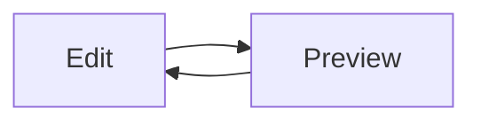

# peekpane

Local previews, right beside your work.

- [x] Markdown tables and task lists
- [x] Live changes without a web server
- [x] Neovim unsaved-buffer updates

| Format | Preview |
| --- | --- |
| Markdown | Tables, footnotes, code and math |
| HTML | Local styles and images |
| Images | Fit / actual size |

```js
console.log('Hello, peekpane');
```

Inline math: $E = mc^2$.



All renderer assets are local.[^1]

[^1]: See README for the local-file trust model.
